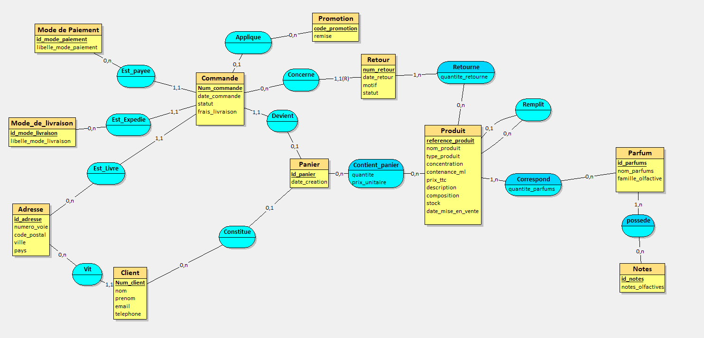

# Mini-projet BDD – Partie 1

Pour ce projet on a choisi le domaine des parfums en s'inspirant de la maison Dries Van Noten. Cette partie 1 contient l'analyse des besoins (prompt, règles de gestion, dictionnaire de données) et le MCD.

- Binôme : *Maaz NORAT, Khevin VONGKORAD *
- Outil de modélisation : Looping

## Fichiers du dépôt

```
README.md
MCD_Complete.loo   (fichier source Looping)
MCD_image.png   (image du MCD)
```

## Sommaire

1. [Analyse des besoins](#1-analyse-des-besoins)
2. [MCD](#2-mcd)
3. [Ce qu'on a changé et pourquoi](#3-ce-quon-a-changé-et-pourquoi)

---

## 1. Analyse des besoins

### 1.1 Le prompt

Voici le prompt envoyé à l'IA. On est parti de la base de prompt fournie et on a ajouté notre domaine, le contexte et les références.

```text
Tu travailles dans le domaine de la parfumerie de luxe. Tu representes la marque Dries Van Noten qui a comme activité la confection d'articles de modes mais tu te specialises dans les parfums de la marque. C'est une entreprise comme Celine et Louis Vuitton. Nous cherchons a récolter des donnees via différents sites internet que ce soit leur site officiel ou des articles. Inspire-toi du site web et des articles :

- Eaux de Parfum | Dries Van Noten
- Eaux de Toilette | Dries Van Noten
- Coffrets découverte et coffrets de voyage | Dries Van Noten
- Eau de Parfum Refills | Dries Van Noten

Ton entreprise veut appliquer MERISE pour concevoir un système d'information. Tu es chargé de la partie analyse, c'est-à-dire de collecter les besoins auprès de l'entreprise. Elle a fait appel à un étudiant en ingénierie informatique pour réaliser ce projet, tu dois lui fournir les informations nécessaires pour qu'il applique ensuite lui-même les étapes suivantes de conception et développement de la base de données. D'abord, établis les règles de gestions des données de ton Dries Van Noten, sous la forme d'une liste à puce. Elle doit correspondre aux informations que fournit quelqu'un qui connaît le fonctionnement de l'entreprise, mais pas comment se construit un système d'information. Ensuite, à partir de ces règles, fournis un dictionnaire de données brutes avec les colonnes suivantes, regroupées dans un tableau : signification de la donnée, type, taille en nombre de caractères ou de chiffres. Il doit y avoir entre 25 et 35 données. Il sert à fournir des informations supplémentaires sur chaque donnée (taille et type) mais sans a priori sur comment les données vont être modélisées ensuite. Fournis donc les règles de gestion et le dictionnaire de données.
```

### 1.2 Ce que l'IA a renvoyé (tel quel)

**Sources consultées** : fiches revendeurs 24S, MECCA et Niche Beauty (le site officiel n'était pas accessible directement). Elles montrent que le coffret Modepaleis réunit 10 échantillons de 2 ml, que le coffret Hanover Square en contient 5, et que les recharges existent en 200 ml, avec des prix différents selon le parfum. Les règles ci-dessous s'appuient sur ces éléments et sur la structure du site officiel que tu as indiquée. À valider avec le client pour les points non vérifiables (TVA, stocks, livraison).

#### Règles de gestion

**Produits et parfums**

- La maison propose des parfums, chacun identifié par un nom unique (ex. « Soie Malaquais »).
- Un parfum appartient à une famille olfactive et se décrit par ses notes (ex. fleur d'oranger, santal).
- Un parfum est commercialisé en Eau de Parfum. Certains parfums existent aussi en Eau de Toilette.
- Chaque produit vendu porte une référence unique. Il correspond à un seul parfum, dans une seule concentration et une seule contenance.
- Un même parfum peut être vendu en plusieurs contenances : flacon, échantillon de 2 ml, recharge de 200 ml.
- Chaque produit a un prix TTC. Le prix varie selon le parfum, la concentration et la contenance.
- Chaque produit a une description commerciale, une liste de composition (ingrédients) et une date de mise en vente.
- Un produit peut être disponible ou indisponible. Le stock est suivi pour chaque produit.

**Recharges**

- Une recharge contient le même parfum qu'un flacon existant. Elle sert à remplir ce flacon.

**Coffrets**

- Un coffret a un nom (souvent celui d'une boutique de la marque), un type (découverte ou voyage) et son propre prix.
- Un coffret contient plusieurs produits : par exemple 10 échantillons de 2 ml pour la collection complète, ou 5 échantillons pour une sélection.
- Un coffret est vendu comme un produit à part entière, avec sa référence et son stock.
- Un même parfum peut figurer dans plusieurs coffrets. Dans un coffret, chaque parfum est présent en une quantité précise.

**Clients et commandes**

- Un client s'inscrit avec son nom, son prénom, son e-mail, son téléphone et son adresse de livraison. Il peut aussi commander sans être inscrit.
- Un client peut passer plusieurs commandes. Chaque commande appartient à un seul client.
- Une commande porte un numéro unique, une date et un statut (en préparation, expédiée, livrée, retournée).
- Une commande contient un ou plusieurs produits, chacun en une certaine quantité, avec le prix appliqué au moment de l'achat.
- Une commande est payée par un mode de paiement (carte, PayPal, etc.).
- Une commande est livrée selon un mode de livraison (standard, express). Elle a des frais de livraison, éventuellement offerts au-delà d'un montant.
- Un code promotionnel (ex. remise de 10 % sur la première commande) peut être appliqué à une commande. Il a un code et un pourcentage de remise.
- Un client peut retourner un produit. Le retour est gratuit et suit la commande d'origine.

#### Dictionnaire de données brutes

| N° | Signification de la donnée | Type | Taille |
|---|---|---|---|
| 1 | Référence du produit | Alphanumérique | 10 |
| 2 | Nom commercial du produit | Alphanumérique | 80 |
| 3 | Nom du parfum | Alphanumérique | 40 |
| 4 | Type de produit (flacon, échantillon, recharge, coffret) | Alphanumérique | 20 |
| 5 | Concentration (Eau de Parfum, Eau de Toilette) | Alphanumérique | 20 |
| 6 | Famille olfactive | Alphanumérique | 30 |
| 7 | Notes olfactives | Alphanumérique | 200 |
| 8 | Description commerciale | Alphanumérique | 1000 |
| 9 | Composition (liste des ingrédients) | Alphanumérique | 1500 |
| 10 | Contenance en millilitres | Numérique | 4 |
| 11 | Prix TTC en euros | Numérique | 7 (dont 2 décimales) |
| 12 | Quantité en stock | Numérique | 5 |
| 13 | Disponibilité du produit (oui/non) | Booléen | 1 |
| 14 | Date de mise en vente | Date | 10 |
| 15 | Nom du coffret | Alphanumérique | 50 |
| 16 | Type de coffret (découverte, voyage) | Alphanumérique | 20 |
| 17 | Nombre de flacons ou échantillons dans le coffret | Numérique | 2 |
| 18 | Quantité d'un parfum donné dans un coffret | Numérique | 2 |
| 19 | Numéro du client | Numérique | 8 |
| 20 | Nom du client | Alphanumérique | 50 |
| 21 | Prénom du client | Alphanumérique | 50 |
| 22 | Adresse e-mail du client | Alphanumérique | 100 |
| 23 | Téléphone du client | Alphanumérique | 15 |
| 24 | Adresse de livraison | Alphanumérique | 150 |
| 25 | Numéro de commande | Alphanumérique | 12 |
| 26 | Date de commande | Date | 10 |
| 27 | Statut de la commande | Alphanumérique | 20 |
| 28 | Quantité commandée d'un produit | Numérique | 3 |
| 29 | Prix unitaire appliqué à la commande | Numérique | 7 (dont 2 décimales) |
| 30 | Mode de paiement | Alphanumérique | 20 |
| 31 | Mode de livraison | Alphanumérique | 30 |
| 32 | Frais de livraison en euros | Numérique | 5 (dont 2 décimales) |
| 33 | Code promotionnel | Alphanumérique | 15 |
| 34 | Pourcentage de remise du code promotionnel | Numérique | 3 |
| 35 | Date de retour d'un produit | Date | 10 |

---

## 2. MCD

Le MCD est fait avec Looping (fichier source : `mcd_complet.loo`).



### Les entités

Le premier attribut de chaque entité est son identifiant.

| Entité | Attributs |
|---|---|
| Client | `Num_client`, `nom`, `prenom`, `email`, `telephone` |
| Adresse | `id_adresse`, `numero_voie`, `code_postal`, `ville`, `pays` |
| Panier | `Id_panier`, `date_creation` |
| Commande (forte) | `Num_commande`, `date_commande`, `statut`, `frais_livraison` |
| Retour (faible) | `num_retour` (identifiant relatif de Commande), `date_retour`, `motif`, `statut` |
| Produit | `reference_produit`, `nom_produit`, `type_produit`, `concentration`, `contenance_ml`, `prix_ttc`, `description`, `composition`, `stock`, `date_mise_en_vente` |
| Parfum | `id_parfums`, `nom_parfums`, `famille_olfactive` |
| Notes | `id_notes`, `notes_olfactives` |
| Mode de Paiement | `id_mode_paiement`, `libelle_mode_paiement` |
| Mode_de_livraison | `id_mode_livraison`, `libelle_mode_livraison` |
| Promotion | `code_promotion`, `remise` |

### Les associations

| Association | Côté 1 | Côté 2 | Attributs |
|---|---|---|---|
| Vit | Client 1,1 | Adresse 0,n | |
| Constitue | Panier 0,1 | Client 0,n | |
| Devient | Commande 1,1 | Panier 0,1 | |
| Est_Livre | Commande 1,1 | Adresse 0,n | |
| Est_Expedie | Commande 1,1 | Mode_de_livraison 0,n | |
| Est_payee | Commande 1,1 | Mode de Paiement 0,n | |
| Applique | Commande 0,1 | Promotion 0,n | |
| Concerne | Retour 1,1 (identifiant relatif) | Commande 0,n | |
| Retourne | Retour 1,n | Produit 0,n | `quantite_retourne` |
| Contient_panier | Panier 0,n | Produit 0,n | `quantite`, `prix_unitaire` |
| Correspond | Produit 1,n | Parfum 0,n | `quantite_parfums` |
| Remplit (récursive) | Produit 0,1 (recharge) | Produit 0,n (flacon) | |
| possede | Parfum 1,n | Notes 0,n | |

### Modélisation avancée utilisée

- Une association récursive : Remplit, sur Produit (une recharge remplit un flacon).
- Une entité faible et une entité forte : Retour dépend de Commande.

---

## 3. Ce qu'on a changé et pourquoi

### Nombre de données

- L'IA a donné 35 données, ce qui respecte la limite de 25 à 35 demandée dans le prompt. On n'en a donc retiré aucune pour cette raison.
- Le MCD a 45 attributs : 34 viennent du dictionnaire et 11 ont été ajoutés .
- Sur les 35 données du dictionnaire :
  - 31 sont reprises (juste renommées) ;
  - la 24 (adresse) est découpée en 4 attributs ;
  - les 15 et 16 sont fusionnées dans des attributs qui existaient déjà (`nom_produit` et `type_produit`) ;
  - les 13 et 17 ne sont pas mises, on explique pourquoi plus bas.

### Attributs ajoutés (11)

- Identifiants : `id_adresse`, `id_parfums`, `id_notes`, `id_mode_paiement`, `id_mode_livraison`.
- Panier : `Id_panier`, `date_creation`.
- Retour : `num_retour`, `motif`, `statut`.
- Association Retourne : `quantite_retourne`.

### Ce qui change par rapport au dictionnaire de l'IA

| Donnée | Ce qu'on a fait | Pourquoi |
|---|---|---|
| 15 Nom du coffret | Mise dans `nom_produit` (2) | Un coffret est vendu comme un produit (`type_produit` = coffret), donc on a supprimé l'entité Coffret. |
| 16 Type de coffret | Mise dans `type_produit` (4) | Même raison. `type_produit` peut valoir flacon, échantillon, recharge, coffret découverte ou coffret voyage. |
| 17 Nombre de pièces d'un coffret | Pas mise | On peut la retrouver en additionnant les `quantite_parfums` du coffret. Si on la stocke, on a deux fois la même info et elles pourraient ne plus être d'accord, ce qui casse la 3FN. |
| 13 Disponibilité du produit | Pas mise | On peut la déduire du stock (stock à 0 = indisponible). Si on garde les deux, `disponible` dépend de `stock`, donc ça casse la 3FN. |
| 18 Quantité d'un parfum dans un coffret | Attribut `quantite_parfums` de l'association Correspond | Elle dépend du couple produit/parfum, pas d'un seul des deux. |
| 24 Adresse de livraison | Découpée en `numero_voie`, `code_postal`, `ville`, `pays`, avec une entité Adresse (`id_adresse`) | Une adresse n'est pas une donnée atomique. L'entité Adresse sert à la fois pour Client (Vit) et pour Commande (Est_Livre). |
| 7 Notes olfactives | Entité Notes liée à Parfum (association possede) | Un parfum a plusieurs notes et une même note peut être dans plusieurs parfums. |
| 30 Mode de paiement | Entité Mode de Paiement | Les mêmes valeurs (carte, PayPal...) reviennent dans beaucoup de commandes. |
| 31 Mode de livraison | Entité Mode_de_livraison, avec `libelle_mode_livraison` | Pareil que le paiement : standard et express reviennent dans beaucoup de commandes, donc on ne répète pas le libellé à chaque fois. |

### Problèmes relevés dans le retour de l'IA

- La règle « un produit correspond à un seul parfum » est contredite par les coffrets, qui contiennent plusieurs parfums. Du coup l'association Correspond est en 1,n côté Produit.
- La règle « un coffret contient plusieurs produits » : on l'a modélisée avec les parfums. Un coffret est lié aux parfums qu'il contient, avec la quantité de chacun (`quantite_parfums`).
- Les sources de l'IA sont des fiches de revendeurs (24S, MECCA, Niche Beauty), le site officiel n'était pas accessible. Les points TVA, stocks et livraison sont à valider avec le client.

### Nos choix de modélisation

- **Remplit (récursive sur Produit)** : une recharge remplit un flacon. Côté recharge c'est 0,1 (une recharge remplit au plus un flacon), côté flacon c'est 0,n (un flacon peut être rempli plusieurs fois).
- **Retour est une entité faible de Commande** : un retour suit toujours sa commande d'origine, donc son identifiant `num_retour` est relatif à Commande (association Concerne). Retourne relie ensuite le retour aux produits concernés, avec la quantité retournée.
- **Panier** : la commande est créée à partir d'un panier (Devient). Constitue est en 0,1 côté Panier parce qu'on peut commander sans être inscrit. Les lignes de commande (produit, quantité, prix au moment de l'achat) sont dans Contient_panier.
- **`frais_livraison` reste dans Commande** : les frais peuvent être offerts au-delà d'un certain montant, donc ils ne dépendent pas que du mode de livraison.
- **Mode_de_livraison est une entité** et pas un attribut de Commande : Est_Expedie relie chaque commande à un seul mode (1,1), et un mode peut servir pour 0,n commandes.

### À gérer en partie 2

- Un client qui commande sans être inscrit n'a pas de fiche Client, donc on ne garde ni son nom ni son e-mail, seulement l'adresse de livraison de sa commande.
- Un produit retourné doit faire partie de la commande d'origine du retour. Le MCD ne peut pas le dire, ce sera une contrainte à ajouter en SQL.
- Une recharge doit avoir `type_produit` = recharge et ne peut remplir qu'un flacon. Contrainte à ajouter en SQL aussi.
