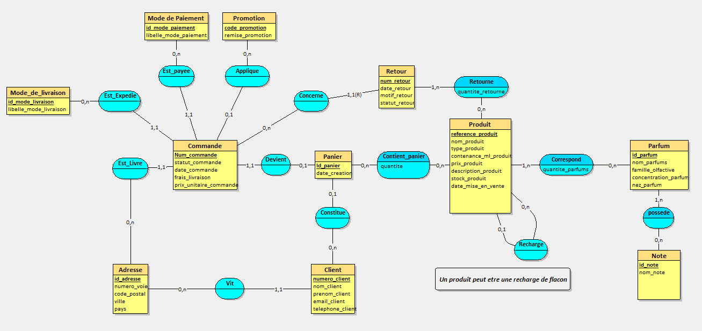
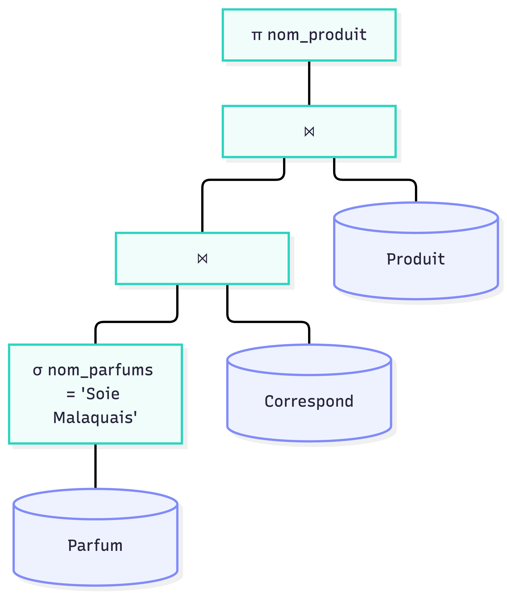

# Mini-projet BDD – Partie 1

- Binôme : *Maaz NORAT, Khevin VONGKORAD *
- Outil de modélisation : Looping

## Choix du sujet de creation du MCD

Dans le cadre du projet de creation d’un modele conceptuel relationnel, nous avons decide de créer une base de donnees s’appuyant sur l’activite commerciale de la marque DRIES VAN NOTEN.

Qui est Dries Van Noten ? 
Dries Van Noten est un tailleur ou createur d’articles de modes specialise dans les combinaisons impossibles. Il est ne et a grandi a Anvers ou il a rejoint la celebre academie de mode d’Anvers. En tant que couturier renomme, il a realise de nombreux defiles de mode ce qui l’a conduit dans le prestigieux univers de la parfumerie de niche.

Le MCD realise se concentre principalement sur les produits de parfumerie et cosmetique que la marque propose. Nous reprenons donc en premier temps, un modele simple de vente avec un Client, un Produit ainsi que d’une Commande. Une differentiation notable entre les entreprises specialisees dans la vente de produits et celles qui vendent des articles de luxe. Les entreprises de luxe souhaitent récupérer les donnees des produits vendus ainsi que celles des clients qui les ont achetes.

L’ecriture de notre prompt

C’est dans cette optique que nous avons sollicite l’IAG Claude pour la precision de ses réponses ainsi que la possibilite de partager des conversation entre binomes.


## Fichiers du dépôt

```
README.md
MCD_Complete.loo   (fichier source Looping)
MCD_image.png   (image du MCD)
projetBD
```

## Sommaire

1. [Analyse des besoins](#1-analyse-des-besoins)
2. [MCD](#2-mcd)
3. [Ce qu'on a changé et pourquoi](#3-ce-quon-a-changé-et-pourquoi)
4. [Création des tables](#4-création-des-tables)
5. [Contraintes d'intégrité](#5-contraintes-dintégrité)

---

## 1. Analyse des besoins

### 1.1 Le prompt

Voici le prompt envoyé à l'IA. On est parti de la base de prompt fournie et on a ajouté notre domaine, le contexte et les références.

```text
Tu travailles dans le domaine de la parfumerie de luxe. Tu representes la marque Dries Van Noten qui a comme activité la confection d'articles de modes mais tu te specialises dans les parfums de la marque. C'est une entreprise comme Celine et Louis Vuitton. Nous cherchons a récolter des donnees via différents sites internet que ce soit leur site officiel ou des articles. Inspire-toi du site web et des articles :

- Eaux de Parfum | Dries Van Noten
- Eaux de Toilette | Dries Van Noten
- Coffrets découverte et coffrets de voyage | Dries Van Noten
- Eau de Parfum Refills | Dries Van Noten

Ton entreprise veut appliquer MERISE pour concevoir un système d'information. Tu es chargé de la partie analyse, c'est-à-dire de collecter les besoins auprès de l'entreprise. Elle a fait appel à un étudiant en ingénierie informatique pour réaliser ce projet, tu dois lui fournir les informations nécessaires pour qu'il applique ensuite lui-même les étapes suivantes de conception et développement de la base de données. D'abord, établis les règles de gestions des données de ton Dries Van Noten, sous la forme d'une liste à puce. Elle doit correspondre aux informations que fournit quelqu'un qui connaît le fonctionnement de l'entreprise, mais pas comment se construit un système d'information. Ensuite, à partir de ces règles, fournis un dictionnaire de données brutes avec les colonnes suivantes, regroupées dans un tableau : signification de la donnée, type, taille en nombre de caractères ou de chiffres. Il doit y avoir entre 25 et 35 données. Il sert à fournir des informations supplémentaires sur chaque donnée (taille et type) mais sans a priori sur comment les données vont être modélisées ensuite. Fournis donc les règles de gestion et le dictionnaire de données.
```

### 1.2 Ce que l'IA a renvoyé (tel quel)

**Sources consultées** : fiches revendeurs 24S, MECCA et Niche Beauty (le site officiel n'était pas accessible directement). Elles montrent que le coffret Modepaleis réunit 10 échantillons de 2 ml, que le coffret Hanover Square en contient 5, et que les recharges existent en 200 ml, avec des prix différents selon le parfum. Les règles ci-dessous s'appuient sur ces éléments et sur la structure du site officiel que tu as indiquée. À valider avec le client pour les points non vérifiables (TVA, stocks, livraison).

#### Règles de gestion

**Produits et parfums**

- La maison propose des parfums, chacun identifié par un nom unique (ex. « Soie Malaquais »).
- Un parfum appartient à une famille olfactive et se décrit par ses notes (ex. fleur d'oranger, santal).
- Un parfum est commercialisé en Eau de Parfum. Certains parfums existent aussi en Eau de Toilette.
- Chaque produit vendu porte une référence unique. Il correspond à un seul parfum, dans une seule concentration et une seule contenance.
- Un même parfum peut être vendu en plusieurs contenances : flacon, échantillon de 2 ml, recharge de 200 ml.
- Chaque produit a un prix TTC. Le prix varie selon le parfum, la concentration et la contenance.
- Chaque produit a une description commerciale, une liste de composition (ingrédients) et une date de mise en vente.
- Un produit peut être disponible ou indisponible. Le stock est suivi pour chaque produit.

**Recharges**

- Une recharge contient le même parfum qu'un flacon existant. Elle sert à remplir ce flacon.

**Coffrets**

- Un coffret a un nom (souvent celui d'une boutique de la marque), un type (découverte ou voyage) et son propre prix.
- Un coffret contient plusieurs produits : par exemple 10 échantillons de 2 ml pour la collection complète, ou 5 échantillons pour une sélection.
- Un coffret est vendu comme un produit à part entière, avec sa référence et son stock.
- Un même parfum peut figurer dans plusieurs coffrets. Dans un coffret, chaque parfum est présent en une quantité précise.

**Clients et commandes**

- Un client s'inscrit avec son nom, son prénom, son e-mail, son téléphone et son adresse de livraison. Il peut aussi commander sans être inscrit.
- Un client peut passer plusieurs commandes. Chaque commande appartient à un seul client.
- Une commande porte un numéro unique, une date et un statut (en préparation, expédiée, livrée, retournée).
- Une commande contient un ou plusieurs produits, chacun en une certaine quantité, avec le prix appliqué au moment de l'achat.
- Une commande est payée par un mode de paiement (carte, PayPal, etc.).
- Une commande est livrée selon un mode de livraison (standard, express). Elle a des frais de livraison, éventuellement offerts au-delà d'un montant.
- Un code promotionnel (ex. remise de 10 % sur la première commande) peut être appliqué à une commande. Il a un code et un pourcentage de remise.
- Un client peut retourner un produit. Le retour est gratuit et suit la commande d'origine.

#### Dictionnaire de données brutes

| N° | Signification de la donnée | Type | Taille |
|---|---|---|---|
| 1 | Référence du produit | Alphanumérique | 10 |
| 2 | Nom commercial du produit | Alphanumérique | 80 |
| 3 | Nom du parfum | Alphanumérique | 40 |
| 4 | Type de produit (flacon, échantillon, recharge, coffret) | Alphanumérique | 20 |
| 5 | Concentration (Eau de Parfum, Eau de Toilette) | Alphanumérique | 20 |
| 6 | Famille olfactive | Alphanumérique | 30 |
| 7 | Notes olfactives | Alphanumérique | 200 |
| 8 | Description commerciale | Alphanumérique | 1000 |
| 9 | Composition (liste des ingrédients) | Alphanumérique | 1500 |
| 10 | Contenance en millilitres | Numérique | 4 |
| 11 | Prix TTC en euros | Numérique | 7 (dont 2 décimales) |
| 12 | Quantité en stock | Numérique | 5 |
| 13 | Disponibilité du produit (oui/non) | Booléen | 1 |
| 14 | Date de mise en vente | Date | 10 |
| 15 | Nom du coffret | Alphanumérique | 50 |
| 16 | Type de coffret (découverte, voyage) | Alphanumérique | 20 |
| 17 | Nombre de flacons ou échantillons dans le coffret | Numérique | 2 |
| 18 | Quantité d'un parfum donné dans un coffret | Numérique | 2 |
| 19 | Numéro du client | Numérique | 8 |
| 20 | Nom du client | Alphanumérique | 50 |
| 21 | Prénom du client | Alphanumérique | 50 |
| 22 | Adresse e-mail du client | Alphanumérique | 100 |
| 23 | Téléphone du client | Alphanumérique | 15 |
| 24 | Adresse de livraison | Alphanumérique | 150 |
| 25 | Numéro de commande | Alphanumérique | 12 |
| 26 | Date de commande | Date | 10 |
| 27 | Statut de la commande | Alphanumérique | 20 |
| 28 | Quantité commandée d'un produit | Numérique | 3 |
| 29 | Prix unitaire appliqué à la commande | Numérique | 7 (dont 2 décimales) |
| 30 | Mode de paiement | Alphanumérique | 20 |
| 31 | Mode de livraison | Alphanumérique | 30 |
| 32 | Frais de livraison en euros | Numérique | 5 (dont 2 décimales) |
| 33 | Code promotionnel | Alphanumérique | 15 |
| 34 | Pourcentage de remise du code promotionnel | Numérique | 3 |
| 35 | Date de retour d'un produit | Date | 10 |

---

## 2. MCD

Le MCD est fait avec Looping (fichier source : `mcd_complet.loo`).



A noter que la table "Parfum" ne represente pas un produit mais l'odeur cree par le parfumeur. 

### Les entités

Le premier attribut de chaque entité est son identifiant.

| Entité | Attributs |
|---|---|
| Client | `Num_client`, `nom`, `prenom`, `email`, `telephone` |
| Adresse | `id_adresse`, `numero_voie`, `code_postal`, `ville`, `pays` |
| Panier | `Id_panier`, `date_creation` |
| Commande (forte) | `Num_commande`, `date_commande`, `statut`, `frais_livraison` |
| Retour (faible) | `num_retour` (identifiant relatif de Commande), `date_retour`, `motif`, `statut` |
| Produit | `reference_produit`, `nom_produit`, `type_produit`, `concentration`, `contenance_ml`, `prix_ttc`, `description`, `composition`, `stock`, `date_mise_en_vente` |
| Parfum | `id_parfums`, `nom_parfums`, `famille_olfactive` |
| Notes | `id_notes`, `notes_olfactives` |
| Mode de Paiement | `id_mode_paiement`, `libelle_mode_paiement` |
| Mode_de_livraison | `id_mode_livraison`, `libelle_mode_livraison` |
| Promotion | `code_promotion`, `remise` |

### Les associations

| Association | Côté 1 | Côté 2 | Attributs |
|---|---|---|---|
| Vit | Client 1,1 | Adresse 0,n | |
| Constitue | Panier 0,1 | Client 0,n | |
| Devient | Commande 1,1 | Panier 0,1 | |
| Est_Livre | Commande 1,1 | Adresse 0,n | |
| Est_Expedie | Commande 1,1 | Mode_de_livraison 0,n | |
| Est_payee | Commande 1,1 | Mode de Paiement 0,n | |
| Applique | Commande 0,1 | Promotion 0,n | |
| Concerne | Retour 1,1 (identifiant relatif) | Commande 0,n | |
| Retourne | Retour 1,n | Produit 0,n | `quantite_retourne` |
| Contient_panier | Panier 0,n | Produit 0,n | `quantite`, `prix_unitaire` |
| Correspond | Produit 1,n | Parfum 0,n | `quantite_parfums` |
| Remplit (récursive) | Produit 0,1 (recharge) | Produit 0,n (flacon) | |
| possede | Parfum 1,n | Notes 0,n | |

### Modélisation avancée utilisée

- Une association récursive : Remplit, sur Produit (une recharge remplit un flacon).
- Une entité faible et une entité forte : Retour dépend de Commande.

---

## 3. Ce qu'on a changé et pourquoi

### Nombre de données

- L'IA a donné 35 données, ce qui respecte la limite de 25 à 35 demandée dans le prompt. On n'en a donc retiré aucune pour cette raison.
- Le MCD a 45 attributs : 34 viennent du dictionnaire et 11 ont été ajoutés .
- Sur les 35 données du dictionnaire :
  - 31 sont reprises (juste renommées) ;
  - la 24 (adresse) est découpée en 4 attributs ;
  - les 15 et 16 sont fusionnées dans des attributs qui existaient déjà (`nom_produit` et `type_produit`) ;
  - les 13 et 17 ne sont pas mises, on explique pourquoi plus bas.

### Attributs ajoutés (11)

- Identifiants : `id_adresse`, `id_parfums`, `id_notes`, `id_mode_paiement`, `id_mode_livraison`.
- Panier : `Id_panier`, `date_creation`.
- Retour : `num_retour`, `motif`, `statut`.
- Association Retourne : `quantite_retourne`.

### Ce qui change par rapport au dictionnaire de l'IA

| Donnée | Ce qu'on a fait | Pourquoi |
|---|---|---|
| 15 Nom du coffret | Mise dans `nom_produit` (2) | Un coffret est vendu comme un produit (`type_produit` = coffret), donc on a supprimé l'entité Coffret. |
| 16 Type de coffret | Mise dans `type_produit` (4) | Même raison. `type_produit` peut valoir flacon, échantillon, recharge, coffret découverte ou coffret voyage. |
| 17 Nombre de pièces d'un coffret | Pas mise | On peut la retrouver en additionnant les `quantite_parfums` du coffret. Si on la stocke, on a deux fois la même info et elles pourraient ne plus être d'accord, ce qui casse la 3FN. |
| 13 Disponibilité du produit | Pas mise | On peut la déduire du stock (stock à 0 = indisponible). Si on garde les deux, `disponible` dépend de `stock`, donc ça casse la 3FN. |
| 18 Quantité d'un parfum dans un coffret | Attribut `quantite_parfums` de l'association Correspond | Elle dépend du couple produit/parfum, pas d'un seul des deux. |
| 24 Adresse de livraison | Découpée en `numero_voie`, `code_postal`, `ville`, `pays`, avec une entité Adresse (`id_adresse`) | Une adresse n'est pas une donnée atomique. L'entité Adresse sert à la fois pour Client (Vit) et pour Commande (Est_Livre). |
| 7 Notes olfactives | Entité Note liée à Parfum (association possede) | Un parfum a plusieurs notes et une même note peut être dans plusieurs parfums. |
| 30 Mode de paiement | Entité Mode de Paiement | Les mêmes valeurs (carte, PayPal...) reviennent dans beaucoup de commandes. |
| 31 Mode de livraison | Entité Mode_de_livraison, avec `libelle_mode_livraison` | Pareil que le paiement : standard et express reviennent dans
beaucoup de commandes, donc on ne répète pas le libellé à chaque fois. |
| 11 Prix TTC en euros | Remplace par 'prix_produit' | Dans notre contexte, le prix TTC est implicite |
| 9 Composition | Remplace par l'attribut 'nom_note' dans la table Note | La composition ne respecte pas la 1N car elle possede plusieurs ingredients. Elle est de plus obsolete car la table Note existe deja. |
| Remplit | Modification du nom par 'Recharge' | Beaucoup plus explicite, une recharge peut recharger un flacon de parfum. |
| Nez ou Parfumeur | Ajout de l'attribut 'nez_parfum' | On considere que l'attribut est important a renseigner |

### Problèmes relevés dans le retour de l'IA

- La règle « un produit correspond à un seul parfum » est contredite par les coffrets, qui contiennent plusieurs parfums. Du coup l'association Correspond est en 1,n côté Produit.
- La règle « un coffret contient plusieurs produits » : on l'a modélisée avec les parfums. Un coffret est lié aux parfums qu'il contient, avec la quantité de chacun (`quantite_parfums`).
- Les sources de l'IA sont des fiches de revendeurs (24S, MECCA, Niche Beauty), le site officiel n'était pas accessible. Les points TVA, stocks et livraison sont à valider avec le client.

### Nos choix de modélisation

- **Remplit (récursive sur Produit)** : une recharge remplit un flacon. Côté recharge c'est 0,1 (une recharge remplit au plus un flacon), côté flacon c'est 0,n (un flacon peut être rempli plusieurs fois).
- **Retour est une entité faible de Commande** : un retour suit toujours sa commande d'origine, donc son identifiant `num_retour` est relatif à Commande (association Concerne). Retourne relie ensuite le retour aux produits concernés, avec la quantité retournée.
- **Panier** : la commande est créée à partir d'un panier (Devient). Constitue est en 0,1 côté Panier parce qu'on peut commander sans être inscrit. Les lignes de commande (produit, quantité, prix au moment de l'achat) sont dans Contient_panier.
- **`frais_livraison` reste dans Commande** : les frais peuvent être offerts au-delà d'un certain montant, donc ils ne dépendent pas que du mode de livraison.
- **Mode_de_livraison est une entité** et pas un attribut de Commande : Est_Expedie relie chaque commande à un seul mode (1,1), et un mode peut servir pour 0,n commandes.

### À gérer en partie 2

- Un client qui commande sans être inscrit n'a pas de fiche Client, donc on ne garde ni son nom ni son e-mail, seulement l'adresse de livraison de sa commande.
- Un produit retourné doit faire partie de la commande d'origine du retour. Le MCD ne peut pas le dire, ce sera une contrainte à ajouter en SQL.
- Une recharge doit avoir `type_produit` = recharge et ne peut remplir qu'un flacon. Contrainte à ajouter en SQL aussi.

## 4. Création des tables

On a passé le MCD en tables pour MySQL. Le script est coupé en trois fichiers, à lancer dans cet ordre :

| Fichier | Ce qu'il fait |
|---|---|
| `drop_table_file.sql` | supprime les tables |
| `01_creation.sql` | crée les 15 tables (types, `NOT NULL`, clés primaires et étrangères) |
| `02_contrainte.sql` | ajoute les contraintes d'intégrité |

### Ordre de suppression

Dans `drop_table_file.sql` on supprime d'abord les tables qui contiennent des clés étrangères (`Retourne`, `Retour`, `Correspond`, `possede`, `Contient_panier`, `Commande`, `Panier`, `Client`, `Adresse`), puis celles qui sont référencées. Le `IF EXISTS` permet de relancer le script sans erreur.

### Du MCD aux tables

- Les associations 0,n - 0,n sont devenues des tables : `Contient_panier`, `Correspond`, `possede` et `Retourne`.
- `Retour` a une clé primaire composée (`Num_commande`, `num_retour`), à cause de l'identifiant relatif.
- Les associations avec un 1,1 côté Commande sont des clés étrangères dans `Commande` (paiement, livraison, adresse, panier).
- `Commande.Id_panier` est `UNIQUE` : Devient est en 0,1 côté Panier, donc un panier ne donne qu'une commande au plus.
- Recharge est la colonne `reference_produit_1` de `Produit`, clé étrangère vers `Produit`. Elle est facultative puisque tous les produits ne sont pas des recharges.
- Constitue est la colonne `numero_client` dans `Panier`, facultative aussi (on peut commander sans être inscrit).
- Applique est la colonne `code_promotion` dans `Commande`, facultative (pas de promotion sur toutes les commandes).

### Choix des types

| Attribut | Type | Pourquoi |
|---|---|---|
| `telephone_client` | `CHAR(10)` | un `INT` perd le 0 du début et ne tient pas sur 10 chiffres |
| `code_postal` | `CHAR(5)` | un `INT` transformerait `01000` en `1000` |
| `numero_voie` | `VARCHAR(10)` | pour pouvoir écrire « 12 bis » |
| `prix_produit`, `prix_unitaire_commande`, `frais_livraison` | `DECIMAL(10,2)` | sous MySQL, `DECIMAL` tout seul vaut `DECIMAL(10,0)`, donc 19,99 serait arrondi à 20 |
| `description_produit` | `VARCHAR(255)` | 50 caractères c'est trop court pour une description |

### NOT NULL

Tous les attributs sont `NOT NULL` sauf trois, qui sont facultatifs d'après les cardinalités du MCD : `Panier.numero_client`, `Commande.code_promotion` et `Produit.reference_produit_1`.

### Ce qui a changé dans Adresse

- On a ajouté `nom_voie` : l'entité avait un numéro de voie mais pas de nom de rue.
- On a enlevé `pays`. On voulait d'abord un format de téléphone et de code postal international, mais ces formats changent selon le pays et ça compliquait trop l'implémentation. On a donc simplifié : le site vend et livre en France uniquement, ce qui rend `pays` inutile.

---

## 5. Contraintes d'intégrité
### Contraintes sur une seule colonne

| Attribut | Règle |
|---|---|
| `Client.email_client` | format d'e-mail (regex) et `UNIQUE` |
| `Client.telephone_client` | format français : 10 chiffres, commence par 0 puis 1 à 9 |
| `Adresse.code_postal` | 5 chiffres |
| `Mode_de_Paiement.libelle_mode_paiement` | `paypal`, `mastercard` ou `visa` |
| `Commande.statut_commande` | `en attente`, `en cours` ou `livré` |
| `Retour.statut_retour` | `en attente`, `en cours` ou `retourné` |
| `Produit.prix_produit` | strictement positif |
| `Produit.stock_produit` | supérieur ou égal à 0 |
| `Produit.contenance_ml_produit` | strictement positive |
| `Parfum.concentration_parfum` | entre 1 et 100 (c'est un pourcentage) |
| `Promotion.remise_promotion` | entre 1 et 100 (c'est un pourcentage) |
| `Commande.frais_livraison` | supérieur ou égal à 0 (la livraison peut être offerte) |
| `Commande.prix_unitaire_commande` | supérieur ou égal à 0 |
| `Contient_panier.quantite` | strictement positive |
| `Correspond.quantite_parfums` | strictement positive |
| `Retourne.quantite_retourne` | strictement positive |

Il y a aussi une contrainte entre deux colonnes d'une même table : `Produit.reference_produit_1` doit être différent de `Produit.reference_produit`, un produit ne peut pas être sa propre recharge.

### Nos choix

- **Statuts** : on a gardé trois valeurs au lieu des quatre données par l'IA (en préparation, expédiée, livrée, retournée). Pour un retour on dit `retourné` et pas `livré`, parce qu'un retour n'est pas livré.
- **Recharge** : une recharge est un produit différent du flacon qu'elle remplit, et une recharge ne peut pas elle-même être rechargée (pas de chaîne de recharges).
- **Retours** : la quantité retournée est strictement positive, sinon un retour d'un produit en quantité 0 n'aurait pas de sens.

### Règles entre plusieurs tables

Ces règles ne sont pas appliquées par la base. Elles portent sur plusieurs tables, et un CHECK MySQL ne peut pas lire une autre table. Il faudrait des triggers, mais on ne les a pas encore vus en cours, donc on ne les a pas ajoutés. Elles restent des règles de gestion que l’application devra vérifier.

1. `Retour.date_retour` doit être après `Commande.date_commande` (via Concerne). `date_retour` est la date de confirmation du retour.
2. Pour une même commande et un même produit, la somme des `quantite_retourne` ne dépasse pas la quantité de ce produit dans le panier de la commande. Le produit retourné doit aussi faire partie de ce panier. C'est la règle dont on parlait en partie 2 dans le paragraphe sur les produits retournés.
3. Le produit référencé par `reference_produit_1` n'est pas lui-même une recharge.
4. Une recharge et le produit qu'elle remplit correspondent au même parfum (via Correspond).
5. `Panier.date_creation` est avant ou le même jour que `Commande.date_commande`.

### Insertion de nos données

Nous avons choisi Claude.IA afin de créer nos données. L'objectif était de créer une base la plus exploitable possible en incluant des doublons pour mieux tester notre base, voici le script utilisé :

-------------------------------------------------------

Donne les requêtes d’insertion permettant de remplir la base de données dont le modèle relationnel est le suivant sont envoyes dans les fichiers 1_creation.sql
Les clés primaires correspondent aux id, sauf si autre chose est précisé (quand c'est un attribut composé) les clés étrangères sont identifiées par les #, et ont le même nom que les clés primaires auxquelles elles font référence 
Les éléments de la base de données doivent être repris en fonctions des informations dont tu disposes pour la marque DRIES VAN NOTEN en parfumerie uniquement.
Les produits sont au nombre de 4 dont voici les caracteristiques :
-	Nom : Flacon, type : Flacon , contenance : 100ml , prix : 275, description : « flacon 100ml rechargeable » 
-	Nom : recharge , type : Recharge , contenance : 100ml , prix : 275, description : « flacon 100ml rechargeable » 
 
Il doit y avoir : 
20 lignes pour la table Parfum qui sont les parfums de la marque DRIES VAN NOTEN qui ont au moins 5 notes chacun, 60 lignes pour la table Note. La table Produit est composée de 3 types de produits : flacon , recharge, set. Voici les informations des produits beneficiants de sets :
-	Nom : antwerp set, type : set, contenance : 40, prix : 133, description : « set iconique des 4 best sellers », stock : 12, correspond a quatre parfums : Soie Malaquais, Fleur du Mal, Camomille Satin, Rock the Myrrh
-	Nom : floral set, type : set, contenance : 30, prix : 187, description : « set iconique des 3 best sellers floraux », stock : 8, correspond a trois parfums : Soie Malaquais, Fleur du Mal, Vanille Camouflage
-	Nom : woody set, type : set, contenance : 30, prix : 187, description : « set iconique des 3 best sellers boisees», stock : 15, correspond a trois parfums : Cannabis Patchouli, Crazy Basil, Rock the Myrrh

Pour tous les autres produits dont le type est « recharge » ou « flacon », créer des produits pour chacun des parfums existants. 
Il doit aussi avoir :
20 lignes pour la table Panier qui contiennent un ou plusieurs produits, 60 lignes pour la table Client chaque client est lie a une adresse et il est possible que deux clients partagent la meme adresse. 
40 lignes de Commandes, 4 lignes de Mode_de_Paiement (paypal, visa, mastercard, alipay), 5 lignes de promotions, 6 lignes de Mode_de_Livraison, 7 lignes de Retour et 7 lignes de retourne.

Les clés étrangères doivent faire référence aux clés primaires existantes : donne les lignes en commençant par remplir les tables dans lesquelles il n'y a pas de clés étrangères, puis les tables dans lesquelles les clés étrangères font références à des clés primaires des tables déjà remplies. 

Les données doivent respecter les contraintes de validation suivantes :
ainsi que ses contraintes sont envoyes dans le fichier 2_contraintes.sql

Assure-toi que les noms et prénoms des clients font références à des origines variées et sont mixtes. 

Fournis l'ensemble sous la forme d’un script SQL prêt à être exécuté.

-------------------------------------------------------

Les données retournées par l'IA ont été directement exploitables. Il y a eu léger problème concernant les identifiants des retours qui étaient les mêmes et nous aurions aimé que certains noms ou prénoms de clients soient aussi identiques afin de mieux tester les doublons.

### Interrogation de la base de données

SCENARIO D’UTILISATION

Le service Reportings de DRIES VAN NOTEN  est chargé de récupérer les données récoltées de la base de données afin de les transformer en dashboards Power BI afin de les présenter aux décisionnaires des futures actions de l’entreprise. Ces dashboards sont composés de plusieurs pages dont les pages :

Ventes : 
- Chiffre d’affaires réalisé au total, par statut et avec les reductions appliquées
- Un tableau décroissant des Top Produits qui ont été vendus (Produit - Quantite - CA)
- Chiffre d’affaires de tous les produits dont le parfum est « Soie Malaquais »

Clients :
- La densité de femmes / hommes qui ont acheté un produit
- Les types de produits achetés par tranche d’age définies (18-25 ; 25-36 ; 36-45 ; +45)
- Un classement des villes les plus acheteuses
- Les clients qui ont le meme age

Commandes :
- Le statut de livraisons
- Le nombre de retours
- Les commandes passées avec un code de promotion et le code qui a le plus été utilise

Parfum :
- Les parfums ainsi que leur composition olfactive
- Les parfums qui ne contiennent pas l’ingredient « vanille »

D'autres requêtes ont aussi été ajoutées permettant de voir les différents produits, certaines informations sur les clients ou comparer des prix.

### Etude du meilleur plan d'intégration

Nous avons opté pour cette requête : Le nom de tous les produits dont le parfum est « Soie Malaquais »

-------------------------------------------------------

SELECT pr.nom_produit

FROM Parfum p

JOIN Correspond c ON c.id_parfum = p.id_parfum

JOIN Produit pr ON pr.reference_produit = c.reference_produit

WHERE p.nom_parfums = "Soie Malaquais" ;

-------------------------------------------------------

Cela correspond en algebre :
π nom_produit ( σ nom_parfums='Soie Malaquais' (Parfum) ⋈ Correspond ⋈ Produit )

Ici, on effectue d'abord les jointures afin de sélectionner tous les produits dont le parfum est "Soie Malaquais"
Comme on peut le voir ici, le résultat n'est pas optimal




π nom_produit                          → 4 lignes
 └─ σ nom_parfums='Soie Malaquais'     → 4 lignes
     └─ ⋈ (Produit)                    → 50 lignes
         ├─ ⋈ (Correspond)             → 50 lignes
         │   ├─ Parfum                 → 20 lignes
         │   └─ Correspond             → 50 lignes
         └─ Produit                    → 43 lignes

π nom_produit                         
 └─ ⋈ (Produit)                        
     ├─ ⋈ (Correspond)                 
     │   ├─ σ nom_parfums='Soie…'      
     │   │   └─ Parfum                
     │   └─ Correspond                 
     └─ Parfum                       
